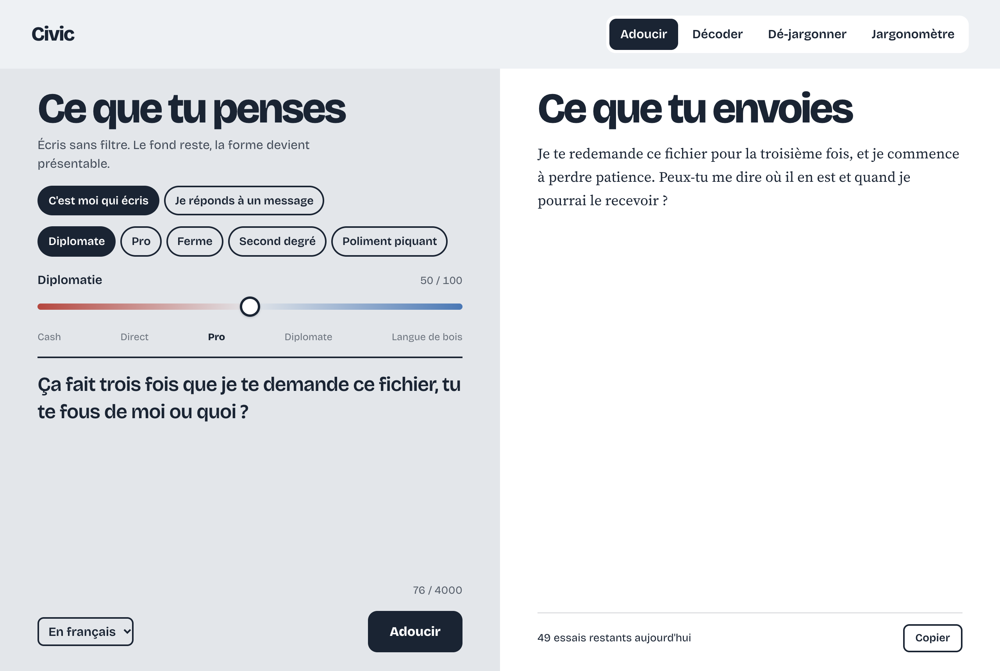
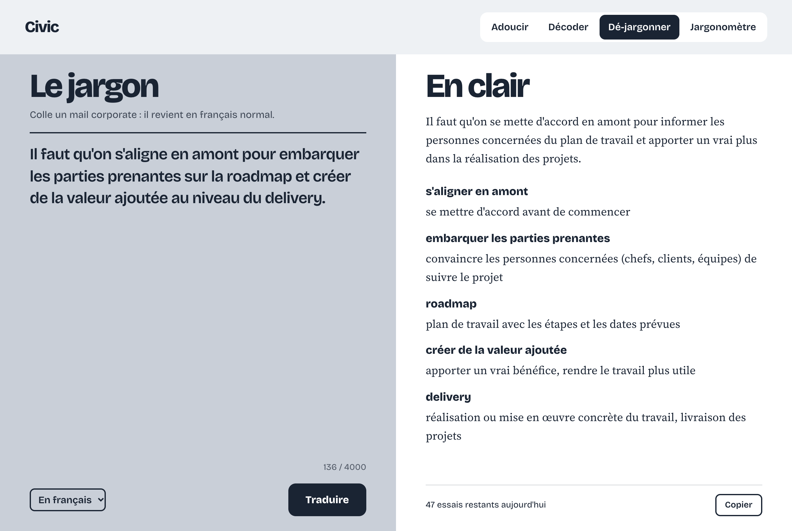
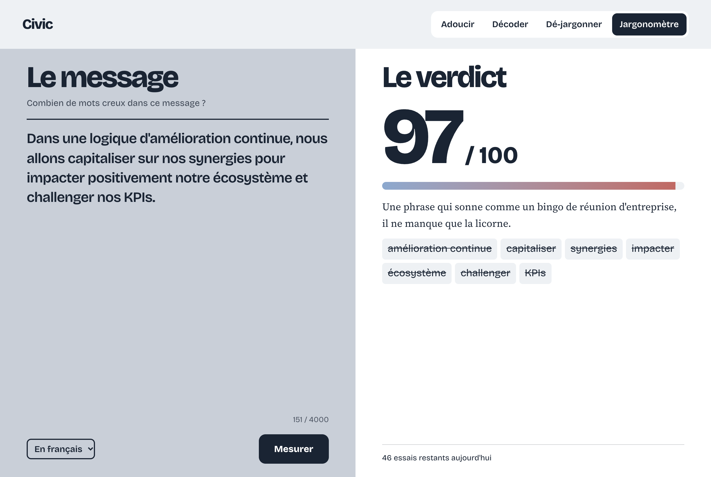

# Civic

English | [Français](README.fr.md)

Civic rewrites your work messages. You type what you really think and get back a message you can actually send. It also works the other way round, and it translates corporate jargon into plain language.

The interface is in French. Results come out in French or English.

Four modes:

- Adoucir (soften): rewrites a blunt message in the tone you pick (diplomatic, professional, firm, tongue-in-cheek, politely snarky), or drafts a reply to a message you received.
- Décoder (decode): guesses what the author of an overly polite email really meant.
- Dé-jargonner (de-jargon): turns a corporate email into plain language and explains each buzzword.
- Jargonomètre (jargon meter): scores a message from 0 to 100 for empty buzzwords.

## Screenshots








## Getting started

You need Node 20.12 or later and Python 3. There are no dependencies to install.

```bash
npm start
```

The app runs at http://localhost:3000.

Without an API key, Civic uses the Claude account logged in on your machine (the `claude` command must be installed and signed in). That is handy locally; for shared use, set an API key.

## Configuration

Everything is set in an optional `.env` file at the project root. Every setting has a default.

```bash
cp .env.example .env
```

| Variable | Default | Purpose |
|---|---|---|
| `ANTHROPIC_API_KEY` | empty | Anthropic API key. When empty, the app uses the `claude` command. |
| `MODEL` | `claude-haiku-5-5` | Model to use. |
| `PORT` | `3000` | Server port. |
| `DAILY_LIMIT` | `100` | Requests per IP per day. |
| `TRUST_PROXY` | `0` | Set to `1` behind a reverse proxy so the quota counts real client IPs. |
| `PYTHON` | `python3` | Interpreter that runs the watermark cleanup. |

An invalid value (for example `PORT=abc`) stops the app at startup with a message naming the variable.

## Architecture

The code follows a hexagonal architecture. The domain and the use case know nothing about HTTP, the Anthropic API or Python. They talk to ports, and adapters plug the technology in.

```
src/
  domain/
    prompts.mjs       tones, input validation, model instructions, JSON parsing
    quota.mjs         per-IP daily request counter
  application/
    process-text.mjs  use case: validate, check quota, call the model, clean up, return the result
  adapters/
    http/server.mjs          driving adapter: HTTP API and web page
    llm/anthropic-api.mjs    LLM port through the Anthropic API
    llm/claude-cli.mjs       LLM port through the local claude command
    scrubber/watermarks.mjs  cleanup port through the Python script
  config.mjs          reads and validates environment variables
  main.mjs            entry point: picks the adapters and wires them together
public/index.html     the single-page interface
test/                 domain, use case and config tests
```

The use case expects three ports:

- `llm.complete(system, text)` returns the model's answer;
- `scrubber.clean(text)` returns the cleaned text;
- `quota.take(clientId)` returns `false` once the daily limit is reached.

Use case errors carry a `code` (`invalid`, `not_found`, `quota`, `parse`, `unavailable`). The HTTP adapter maps them to 400, 404, 429, 502 and 503.

To plug in another model, write an adapter that exposes `complete` and select it in `main.mjs`.

## What the app does to the text

Every instruction sent to the model includes a short version of the [humanizer](https://github.com/blader/humanizer) rules: no em dashes, no filler phrases, no "it's not X, it's Y". The generated text reads like something a person wrote.

Before returning an answer, the server strips the invisible Unicode characters that sometimes watermark AI-generated text. This cleanup is layer A of [watermarks-remover](https://github.com/guillaumemeyer/watermarks-remover) (MIT license, copied into `src/adapters/scrubber/vendor/watermarks/`).

## API

| Method | Route | Body | Response |
|---|---|---|---|
| GET | `/api/quota` | | `{ used_today, daily_limit, remaining }` |
| POST | `/api/transform` | `{ text, tone, mode, diplomacy, language }` | `{ output_text }` |
| POST | `/api/reverse` | `{ text, intensity, language }` | `{ output_text }` |
| POST | `/api/antidote` | `{ text, language }` | `{ result: { translation, terms } }` |
| POST | `/api/bullshit_score` | `{ text, language }` | `{ result: { score, verdict, buzzwords } }` |

Accepted values: `tone` is `diplomatic`, `professional`, `assertive`, `humor` or `passive_aggressive`. `mode` is `reformulate` or `reply`. `diplomacy` ranges from 0 to 100. `intensity` is `franc`, `suffit` or `nuclear`. `language` is `fr` or `en`. Text is limited to 4000 characters.

## Tests

```bash
npm test
```

## Limits

The quota lives in memory: it resets on restart and is not shared across instances. Running several instances means moving it to Redis.

## License

MIT, see [LICENSE](LICENSE). The watermarks-remover code in `src/adapters/scrubber/vendor/watermarks/` keeps its own MIT license.
